# Taxonomy

Two complementary cuts. The **when/what** cut follows the Awesome-Routing-LLMs organisation (pre-judgment, verification, memory-based, system analysis). The **design-space** cut is ours ([[design-space]]).

```mermaid
graph TD
  R[LLM routing] --> PRE[Pre-generation<br/>route on query]
  R --> POST[Post/during generation<br/>observe then decide]
  R --> MEM[Memory-based<br/>retrieve past outcomes]
  R --> SYS[System analysis<br/>benchmarks, theory, security]
  PRE --> P1[Predictive scoring<br/>Hybrid LLM, RouteLLM, Zooter, IRT-Router, P2L, CARROT]
  PRE --> P2[Representation matching<br/>RouterDC, EmbedLLM, Arch-Router, semantic routers]
  PRE --> P3[Constrained / bandit<br/>FORC, OmniRouter, MixLLM, PILOT, MetaLLM]
  PRE --> P4[Effort / compute<br/>BEST-Route, RADAR, CP-Router, DART]
  POST --> C1[Self-assessment cascades<br/>FrugalGPT, AutoMix, Self-REF, SATER, DiSRouter]
  POST --> C2[Collaborative generation<br/>Router-R1, xRouter, MasRouter, MoA]
  POST --> C3[Token/step level<br/>Co-LLM, CITER, R2R, STEER, AgentRouter]
  MEM --> M1[kNN / retrieval<br/>Shnitzer, kNN router, Eagle, ContextualRouter]
  MEM --> M2[Graph<br/>GraphRouter, GMTRouter, PersonalizedRouter, RouteProfile]
  SYS --> S1[Benchmarks<br/>RouterBench, RouterEval, LLMRouterBench, RouterArena, xRouteBench]
  SYS --> S2[Critical analyses<br/>Plateau, gap noise, artifacts, task type, collapse]
  SYS --> S3[Security<br/>Rerouting, DSC, RerouteGuard, R2A]
  SYS --> S4[Economics<br/>Stackelberg, retrials, auctions]
```

| Family | Concept node | Signal | Strength | Weakness |
|---|---|---|---|---|
| Predictive scoring | [[predictive-routers]] | query embedding → per-model score | cheap, simple | learns averages; collapse |
| Representation matching | [[representation-matching-routers]] | query↔model/policy similarity | extensible, fast | topic, not difficulty |
| Non-parametric / graph | [[nonparametric-routers]] | neighbours' outcomes | strong baseline, no training | needs outcome memory |
| Budgeted / online | [[budgeted-online-routing]] | scores + budget/feedback | handles constraints, learns online | estimator errors propagate |
| Cascades | [[cascades]] | cheap answer + verifier | sees the output | pays first call; queue overload |
| Cascade routing | [[cascade-routing]] | any partial observation | optimal given estimators | estimators are hard |
| Reasoning effort | [[reasoning-effort-routing]] | difficulty, drafts, probes | big savings on reasoning models | model-specific knobs |
| Collaborative | [[collaborative-routing]] | multi-call aggregation | exceeds single-model oracle | cost, latency |
| Token/step | [[token-level-routing]], [[agentic-routing]] | per-token or per-step state | fine-grained savings | tokenizer/KV/credit issues |
| Personalized | [[personalized-routing]] | user history, policies | user-aligned | privacy, cold users |
| Serving-aware | [[serving-aware-routing]] | queue, hardware, energy | meets SLOs | rarely quality-aware |
