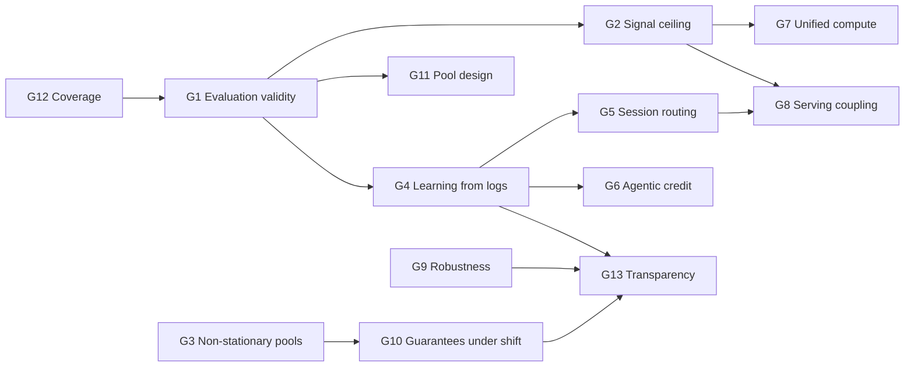

# Gaps in LLM routing and how to push the frontier

The 2026 critical papers ([[oracle-gap]]) change the question. It is no longer "which architecture predicts per-model scores best?", because that is saturated. The real questions are: **is the measured gain real, what information can a router buy, and how does routing behave in live, changing, adversarial, multi-step, multi-user systems?**

## The thirteen gaps

| # | Gap | One-line diagnosis | Evidence nodes |
|---|---|---|---|
| G1 | [[gap-evaluation-validity]] | Oracle inflated by noise and artifacts; ties within noise; no task-type baseline | [[routing-gap-noise]], [[unsolvability-ceiling]], [[routing-plateau]] |
| G2 | [[gap-query-only-signal-ceiling]] | Query embeddings are saturated; nobody optimizes *what to observe* | [[unified-routing-cascading]], [[prefill-activation-router]], [[dart]] |
| G3 | [[gap-nonstationary-pools]] | Models, prices and versions change weekly; probe design ad hoc | [[uniroute]], [[zerorouter]] |
| G4 | [[gap-learning-from-logs]] | Deployment gives bandit, implicit, confounded feedback; academia uses full-information matrices | [[user-retrials]], [[gpt5-router]] |
| G5 | [[gap-session-level-routing]] | Switching costs (cache, style, state) across turns ignored | [[personalizedrouter]] |
| G6 | [[gap-agentic-credit-assignment]] | Step-level decisions, trajectory-level labels | [[agentrouter-agentic]], [[router-r1]] |
| G7 | [[gap-unified-compute-allocation]] | Model, effort, samples, tools and retrieval routed separately | [[best-route]], [[reasoning-effort-routing]] |
| G8 | [[gap-serving-coupling]] | Quality routers blind to queues, caches, energy | [[routerwise]] |
| G9 | [[gap-adversarial-robustness]] | Router is an unprotected control plane; safety not an objective | [[rerouting-llm-routers]], [[dsc-robustness]] |
| G10 | [[gap-guarantees-under-shift]] | Guarantees assume i.i.d.; operators need "never worse than baseline" | [[carrot]] |
| G11 | [[gap-pool-design]] | Which models belong in the pool is unprincipled | [[llmrouterbench]], [[routereval]] |
| G12 | [[gap-coverage]] | English, text, short-context, generic domains only | [[multimodal-routing]] |
| G13 | [[gap-transparency-and-control]] | Provider routers misaligned with users; no auditing | [[user-choice-stackelberg]], [[gpt5-router]] |

## How the gaps depend on each other

**G1 is the root.** Until the field measures routers honestly, claimed progress on every other gap is uncertain. **G2 and G4 are the main levers**: richer information at decision time, and learning from the data deployment actually generates.

## Prioritization (impact × feasibility for an academic group)

| Priority | Gap | Why now | Feasibility |
|---|---|---|---|
| ★★★ | G1 Evaluation | Field-wide multiplier; protocol pieces exist (multi-sample, artifact audit) | High: open models plus compute |
| ★★★ | G2 Value-of-information routing | Plateau and cascade-routing theory point straight at it | High: open models expose activations and drafts |
| ★★★ | G4 Off-policy routing | Bridges academia and production; OPE tools exist | Medium: needs a simulated logging environment |
| ★★ | G6 Agentic routing | Biggest cost line in 2026 deployments | Medium: agent benchmarks are expensive |
| ★★ | G7 Unified compute allocation | Providers already expose all the knobs | Medium |
| ★★ | G9 Robust and safety-aware routing | Attacks are cheap; defenses immature | High |
| ★★ | G3 Active cold-start profiling | Weekly model releases | High: IRT/CAT tools exist |
| ★ | G8 Serving co-design | Needs a systems testbed | Medium-low |
| ★ | G5 Session routing | Few datasets with switching | Medium |
| ★ | G10 Guarantees under shift | Theory-heavy, high value to operators | Medium |
| ★ | G11 Pool design | Cheap to study offline on RouterEval-scale data | High |
| ★ | G12 Coverage | Dataset-building effort | Medium |
| ★ | G13 Auditing and control | Policy relevance; fingerprinting methods exist | Medium |

## Five theses for pushing the edge
1. **Routing is an information-acquisition problem, not a classification problem.** The next gains come from deciding *what to look at* (activations, drafts, probes) under a cost, which is cascade routing with learned observation actions.
2. **The unit of routing is a trajectory.** Sessions and agent loops, not isolated prompts, are where cost lives and where switching costs and credit assignment bite.
3. **Routers must learn from their own logs.** Production feedback is bandit-style and implicit, so off-policy learning and evaluation should become the default methodology.
4. **The router allocates compute, not models.** Model × effort × samples × tools under one budget, with one shared quality estimator.
5. **The router is infrastructure with stakeholders.** It needs robustness, guarantees, auditability and user control, and its economics must be modelled.

Concrete projects implementing these theses: [[06-research-proposals]].
